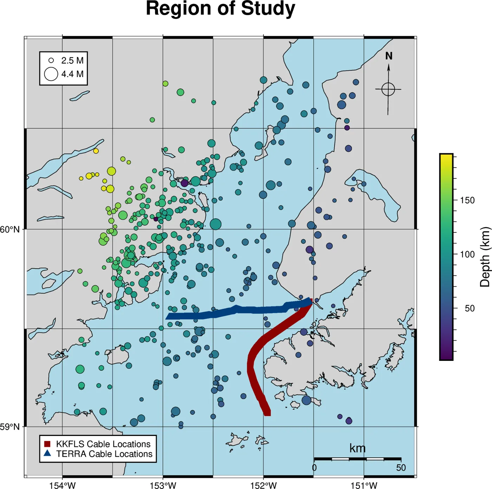
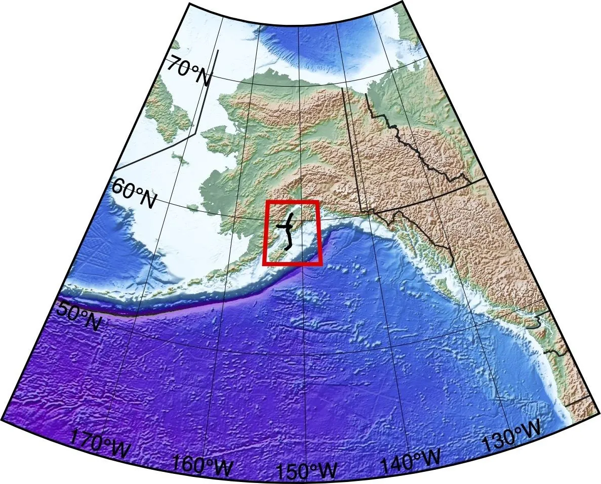

[Project overview · Cook Inlet, Alaska]{.eyebrow}

[Two fiber-optic cables in Cook Inlet become dense seismic arrays. We pick body-wave arrivals on DAS and broadband stations and invert them with Eikonal tomography to image the subducting Pacific plate.]{.lede}

[A. Mirchandani, E. Biondi, M. Denolle, E. Golos, W. Wilcock, B. Lipovsky, A. Rose]{.text-muted}

[Synthetic checkerboard tests · the field-data inversion will use a different event set]{.eyebrow .ak-facts-label}

::: {.ak-facts}

<b>3</b><small>DAS cables (KKFLS, TERRA, KKFLN)</small>

<b>400</b><small>USGS-cataloged events (synthetic tests)</small>

<b>45</b><small>broadband stations</small>

<b>5–10 km</b><small>structures resolved at 20–70 km depth</small>

:::

::: {layout="[[1,1]]"}
{fig-alt="Map of Cook Inlet with DAS cables and 400 earthquakes colored by depth"}

{fig-alt="Locator map of Alaska with the study area boxed"}
:::

## Where things stand

Synthetic checkerboard tests indicate that DAS resolves 5–10 km structures between roughly 20 and 70 km depth. Tests with the 3D starting model have been run for 100, 50, 20 and 10 km checkers, with DAS + broadband, broadband-only, and inverse-density-weighted data. Current work is finalizing the DAS and broadband pick sets, building covariance weights, and quantifying checkerboard recovery before the first field-data inversion.

## On this site

- [**Results**](results/index.qmd): every checkerboard run, with a depth slider and side-by-side comparison.
- [**Models & data**](models/index.qmd): starting velocity models, pick sets, receivers and events.
- [**Picking**](picking/index.qmd): PhaseNet-DAS vs. the ensemble workflow.
- [**Methods & math**](methods/index.qmd): the forward problem, objective function, and the code that runs them.
- [**Plan**](plan/index.qmd): what's done, what's next, and what we're waiting on.
- [**Literature**](literature/index.qmd): papers with notes on why each matters here.
