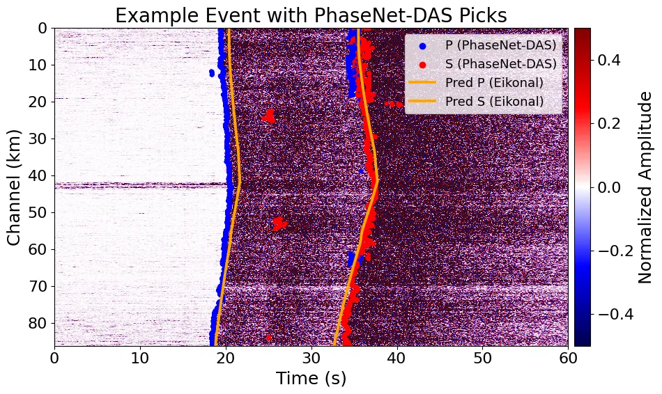
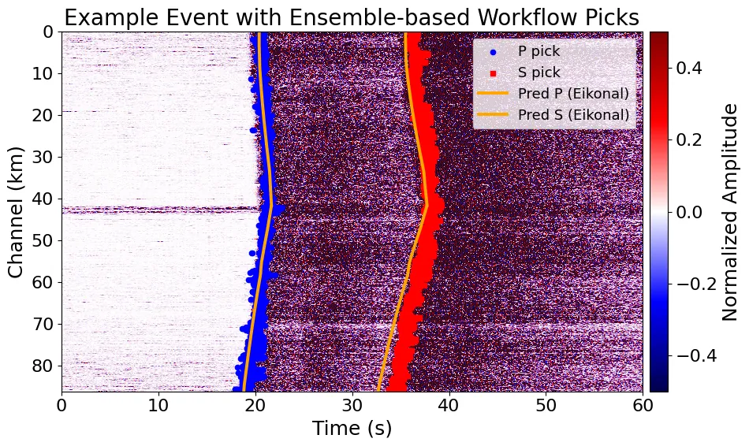
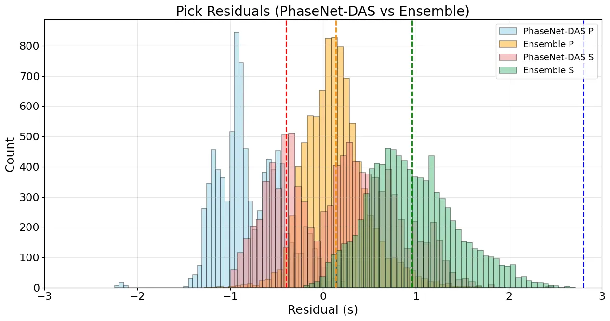

We compared two pickers on the same events: **PhaseNet-DAS** [@zhu2023], a semi-supervised model built for DAS, and an **ensemble workflow** that denoises with masked autoencoders before picking [@shi2025]. PhaseNet-DAS performs reasonably well, but the ensemble picks track the Eikonal predictions from a 1D model more closely.

::: {layout="[[1,1]]"}
{fig-alt="DAS waveform section with PhaseNet-DAS picks"}

{fig-alt="DAS waveform section with ensemble picks"}
:::

{fig-alt="Histogram of pick residuals" width="85%"}

## Decisions so far

- PhaseNet-DAS on the **spatial gradient** of the data picked better than on the original data, so the gradient is used.
- An earlier set of DAS picks was categorized by quality (now outdated).
- Broadband: PhaseNet [@zhu2019] and AEC picks tried.

## Open

- [ ] Select good picks and prep them for inversion
- [ ] Decide the final DAS and BB pick sets (P and S)

See [Pick sets](../models/index.qmd#picks) for the named sets that runs refer to.
